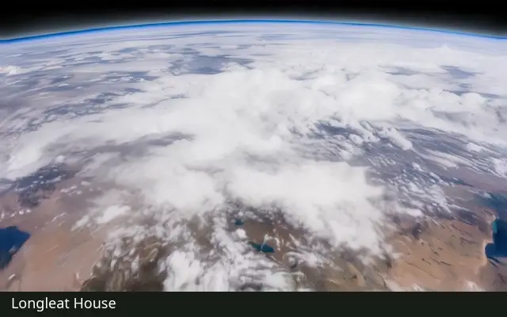

# Earthfall

Pick a landmark and add a portrait. Earthfall makes an 8–10-second dive from orbit, through the clouds, down to that person standing at the landmark.

[](https://earthfall.jamiek.ing/#gallery)

Longleat House → Eilean Donan Castle → Palácio da Pena. The preview loops automatically; [watch the full-quality films below](#example-films).

It runs on your own machine with open-weight models only: FLUX 3 Klein for stills, LTX 2.5 for video and Qwen3.5 4B as the automatic checker. Generation goes through ComfyUI, driven by the Comfy SDK. No paid APIs are called.

Example films (8–10 s each): Longleat House, Bamburgh Castle, Eilean Donan Castle, Château de Chambord and Palácio da Pena. They are in the repository and appear on the page when the app starts; see [Example films](#example-films).

**Live app:** [earthfall.jamiek.ing](https://earthfall.jamiek.ing)

**Demo video (1:58):** [watch on X](https://x.com/jamie_jk/status/2116104753834803415). An entry for the Open Source Higgsfield challenge (#OpenSourceHiggsfield), category Open Weights Only.

An entry for the Open Source Higgsfield challenge (#OpenSourceHiggsfield), category Open Weights Only.

## How it works

The flight is made backwards, then played forwards.

1. **Person and place.** Your portrait sets the person. Photos of the landmark come from Wikimedia Commons, or you upload your own.
2. **Landing.** FLUX 3 places the person at the landmark; LTX 2.5 animates the ending pose (relaxed, look back, wave and so on).
3. **Flight.** LTX 2.5 flies the camera away from the person, over the landscape and up into cloud. Reversed, this is the dive.
4. **Opening.** The film opens on Earth from low orbit, a generic view rather than the destination: a stored photograph of an Earth mostly under cloud, made once with FLUX 3. The camera closes in, gathering speed, and the planet's own clouds grow until they fill the frame. LTX 2.5 renders this from a simple camera guide (the globe only) and carries it into the thickest white cloud of the flight, where the film cuts to the flight inside the cloud, no crossfade.
5. **Checks.** Qwen3.5 checks the flight and the finished film, and an automatic check rejects an opening that does not move. A failed or unsure check stops the build and keeps what was made.

The app's **Workflow** page shows every stage as a graph, with the models, scripts and ComfyUI nodes behind each one. The full settings are in [the canonical workflow](docs/touchdown-canonical-workflow.md).

**Limits.** Beyond the landmark itself, the geography is invented; it is not a map. Qwen is a small model and its checks can miss things, so watch a film before sharing it. Endings marked "trial" in the app fail more often.

## Requirements

- Linux with an NVIDIA GPU with 24 GB VRAM. Developed on an RTX 4090 with 95 GB system RAM.
- Python 3.12 and [uv](https://docs.astral.sh/uv/).
- [ComfyUI](https://github.com/comfyanonymous/ComfyUI) (developed on 0.41.3) and [Ollama](https://ollama.com) for the checker.

Model files. FLUX 3 Klein and LTX 2.5 go in ComfyUI's own model folders, or set `TOUCHDOWN_MODEL_PATHS` to an `extra_model_paths` file that points at them. Gemma4 is LTX 2.5’s text encoder: it encodes the video prompts, while Qwen3.5 performs the separate checks.

| Model | Files |
| --- | --- |
| FLUX 3 Klein | `flux3-image-klein-int8-convrot.safetensors`, `qwen3vl_4b_int8_convrot.safetensors`, `flux2-vae.safetensors` |
| LTX 2.5 | `ltx-2.5-22b-distilled-transformer-comfy-int8-convrot.safetensors`, `ltx-2.5-video-vae-bf16.safetensors`, `ltx-2.5-latent-spatial-upscaler-x2-bf16-1.0.safetensors` |
| LTX 2.5 text encoder (Gemma4) | `gemma4-12b-with-proj-ltx-2.5-comfy-int8-convrot.safetensors` |
| Checker | `qwen3.5:4b` in Ollama (started by `scripts/start_touchdown_vision_checker.sh`) |

**Optional legacy opening:** FLUX.1 Fill expands the overhead landscape for `photographic-grounded-v1`. The default `photographic-generic-orbit-v1` workflow does not use or require it. To run the legacy workflow, install `flux1-fill-dev.safetensors`, `clip_l.safetensors`, `t5xxl_fp16.safetensors` and `ae.safetensors` under `models/FLUX-Fill/diffusion_models`, `text_encoders` and `vae`. These files are verified against `workflows/touchdown/flux-fill-models.json`.

Install the checker model into the project's own Ollama store:

```bash
OLLAMA_MODELS=$PWD/models/vision-checker/ollama ollama pull qwen3.5:4b
```

The worker checks that model's digest against the one the checks were evaluated with, so a newer `qwen3.5:4b` upload will be refused.

## Install

```bash
git clone https://github.com/jamiejk/earthfall && cd earthfall
uv sync --locked --extra touchdown --extra app --extra comfy
```

## Run

The video stages talk to ComfyUI through [comfy-api-proxy](https://pypi.org/project/comfy-api-proxy/) on port 8193; the worker starts and stops ComfyUI itself on 8192. Install the proxy in ComfyUI's own Python and leave it running (the flight's guide clips need the larger upload limit):

```bash
/path/to/comfy-venv/bin/pip install comfy-api-proxy==0.1.6
/path/to/comfy-venv/bin/python -m comfy_api_proxy.cli run --comfyui http://127.0.0.1:8192 \
    --host 127.0.0.1 --port 8193 --max-upload-mb 100 --comfyui-base-dir /path/to/ComfyUI
```

One command then starts the web app and the GPU worker together:

```bash
export TOUCHDOWN_CANONICAL=1
export TOUCHDOWN_PYTHON=$PWD/.venv/bin/python
export TOUCHDOWN_OUTPUT=$PWD/outputs/app
export TOUCHDOWN_COMFY_SERVER_CMD="/path/to/comfy-venv/bin/python main.py --listen 127.0.0.1 --port 8192 --disable-auto-launch"
export TOUCHDOWN_COMFY_SERVER_CWD=/path/to/ComfyUI
export TOUCHDOWN_FLUX3_FREE_URL=http://127.0.0.1:8192
export TOUCHDOWN_COMFY_URL=http://127.0.0.1:8193
uv run touchdown-app --port 8020
```

It checks the models and the frozen workflow files, then opens http://127.0.0.1:8020. Pick a place, add a photo, choose an ending and press **Create film**. The page shows each stage and its check as the film builds.

The app listens on 127.0.0.1 only. Set `TOUCHDOWN_PASSCODE` before making it reachable from other machines. Running the server and the worker on separate machines, 4K refinement and all environment variables are covered in [app/README.md](app/README.md).

## Example films

| Location | Full-quality film |
| --- | --- |
| Longleat House | [Watch MP4](app/examples/longleat-generic-orbit-v1.mp4) |
| Bamburgh Castle | [Watch MP4](app/examples/bamburgh-grounded-v1.mp4) |
| Eilean Donan Castle | [Watch MP4](app/examples/eilean-donan-grounded-v2.mp4) |
| Château de Chambord | [Watch MP4](app/examples/chambord-recipe-v1.mp4) |
| Palácio da Pena | [Watch MP4](app/examples/pena-photographic-v1.mp4) |

The five example films are in `app/examples/`. The app copies them into its gallery and makes their posters the first time it starts, so they are on the page with nothing to run. To install them into another data directory by hand:

```bash
uv run python scripts/install_earthfall_examples.py --gallery /path/to/data/gallery
```

Photo credits for the location references are listed in the app under **Photo credits**.

## Next steps

- A Comfy Cloud backend: the LTX stages already go through the Comfy SDK to a configurable URL, but the custom relay nodes, the FLUX 3 still server and the local checks would need porting first.

## Licence

GPL-3.0-or-later; see [LICENSE](LICENSE). Wikimedia Commons photos keep their own licences, recorded with each film. Place search uses OpenStreetMap (ODbL).

This repository grew out of an earlier measured-terrain project, GeoBlock. Its README is kept at [docs/geoblock-readme.md](docs/geoblock-readme.md).
