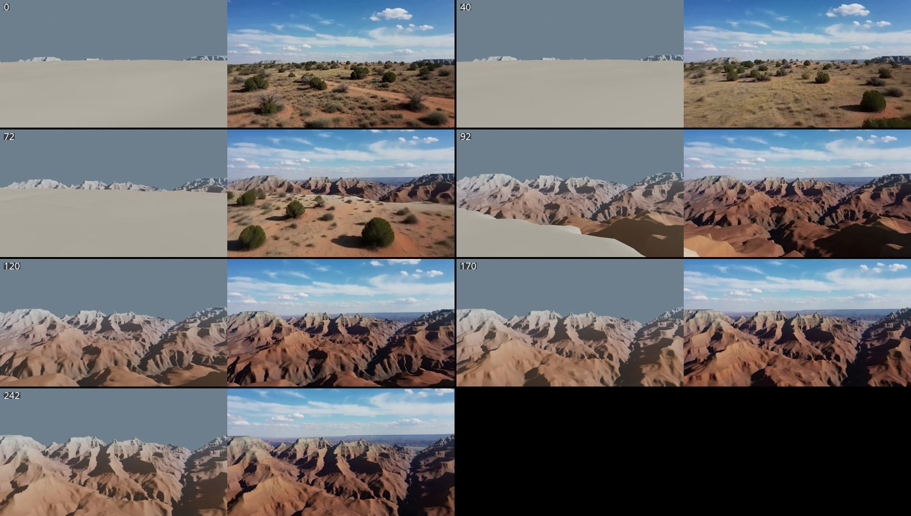
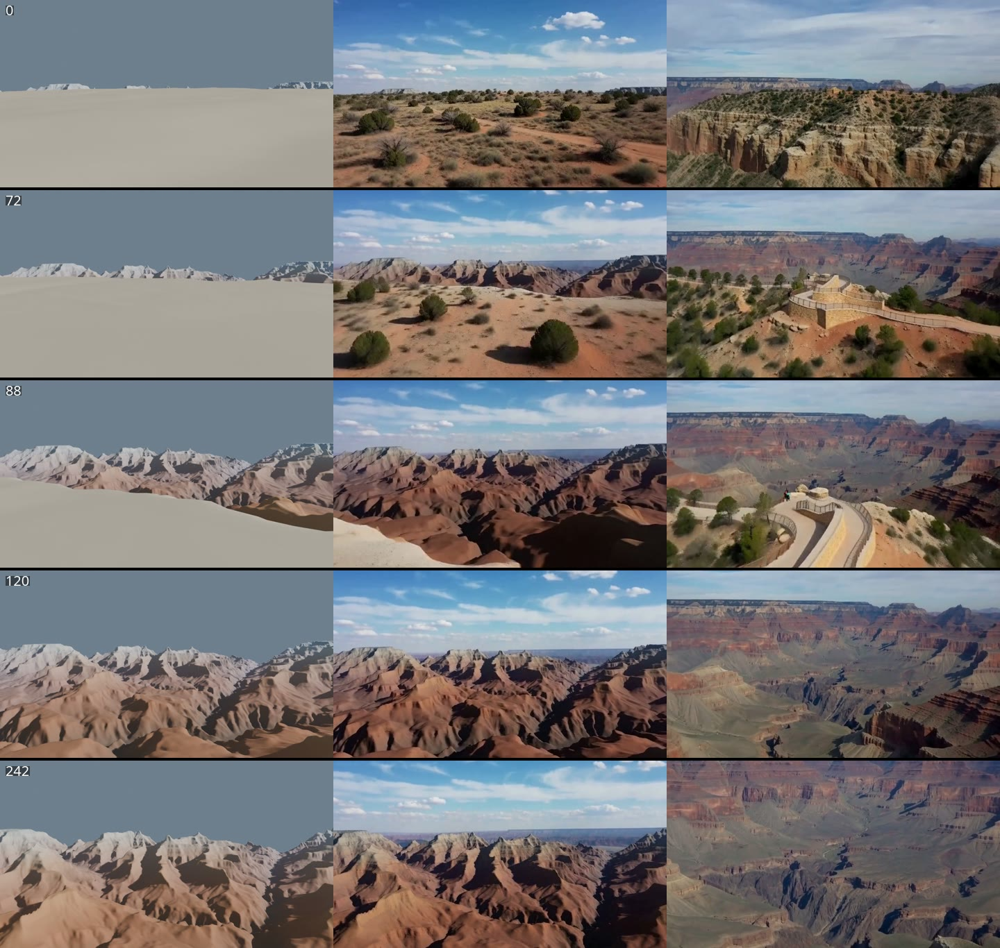

# First H3 run: Grand Canyon rim reveal

*5 October 2026, local RTX 4090.*

The first end-to-end GeoBlock → MiniMax H3 Ref2VA render of the hero shot, driven through the Comfy SDK.



## What ran

```bash
COMFY_BASE_URL=http://127.0.0.1:8189 uv run --extra comfy geoblock-run --name "Mather Point, Grand Canyon" \
  --latitude 36.0617 --longitude -112.1078 --preset "Rim reveal" --duration 10 --h3
```

| Stage | Result |
| --- | --- |
| Blocking (EEVEE, Blender 5.2.2 LTS, GPU) | 243 frames, 1280 × 720, 24 fps; route heading 5°; ~1 min 40 s for the whole blocking job including the scene build |
| H3 Ref2VA (INT8 pruned UNet, NVFP4 Qwen3-VL, fp16 VAE) | 243 frames, 864 × 480, 24 fps, 12 steps at ~103 s/step; ComfyUI reported 24 min 41 s for the graph |
| References | Opening frame + control video only. No `--photo`: no licensed Grand Canyon photos were on disk, and none were downloaded. |

ComfyUI ran with `--disable-smart-memory --reserve-vram 3.5` on `127.0.0.1:8188`; `comfy-api-proxy` 0.1.6 on `127.0.0.1:8189`. Both loopback only. EEVEE rendered headless without a fallback to Cycles.

## Frame review

**Works**

- No cuts, morphing or end-of-clip fade. Unlike the 175-frame Worm's Head take, the last 15 frames hold steady: frame-to-frame difference drops to zero exactly as the control does.
- From the rim crossing to the end (frames ~90–242) H3 follows the control closely. The ridge and side-canyon silhouettes, the shadowed gorge on the right and the flat North Rim skyline land where the blocking put them.
- The pale elevation-ramp tops in the clay render, which read as snow in the blocking, came out as pale cap rock (Kaibab/Coconino-like bands) rather than snow.
- Lighting, sky and haze are consistent across the clip; no flicker.

**Problems**

1. **H3 invents motion over the plateau and reaches the rim ~20 frames early.** The control is almost still for the first ~3 s (mean frame difference 0.1–0.5 on a 0–255 scale) because the camera eases in over untextured clay. H3 instead flies forward fast from frame 0 (difference 7–15), crosses the rim at ~frame 72 while the control crosses at ~92, then drifts back into sync. The flat clay plateau gives the model nothing to lock onto.
2. **The plateau is not Mather Point.** H3 drew open grassland scrub with a red dirt track. The real South Rim here is pinyon–juniper woodland with paved paths and the visitor centre. Place photos are the obvious fix.
3. **Canyon reads as generic red badlands.** No Colorado River, little of the Grand Canyon's banded wall colouring, and the inner-canyon forms are smoothed (10 m DEM, untextured clay). Recognisable as "a big canyon", not clearly as this view.
4. **Blocking framing.** The camera stays near level over the drop, so the shot never looks down into the inner gorge. The clay far wall also looks like a snowy range in the control video, which a viewer of the blocking alone would misread.

## Second take: with Commons place photos

Same route (identical control frames), seed and settings, plus three photos picked by `--auto-photos 3 --heading 5`:

- [View north from Mather Point](https://commons.wikimedia.org/wiki/File:2016-03-20_17_34_43_View_north_from_Mather_Point_in_Grand_Canyon_National_Park,_Arizona.jpg), Famartin, CC BY-SA 4.0
- [View Mather Point](https://commons.wikimedia.org/wiki/File:2012.09.14.090040_View_Mather_Point_Grand_Canyon_Arizona.jpg), Hermann Luyken, CC0
- [Grand Canyon Mather Point](https://commons.wikimedia.org/wiki/File:0427_Grand_Canyon_Mather_Point_(5333623276).jpg), Grand Canyon National Park, CC BY 2.0

ComfyUI reported 27 min 53 s.



**Better:** It now looks like the Grand Canyon. The real rock banding (red Supai and Redwall layers, the grey-green Tonto Platform), the inner gorge and the flat North Rim skyline are all there. The rim is pinyon–juniper rather than open scrub, and there is no invented dirt track. Issues 2 and 3 above are largely fixed.

**Worse:**

- **The photos outweigh the blocking.** Frame 0 already starts at a cliff edge rather than on the plateau. After the rim, H3 frames the canyon the way the photos do, looking down across a broad basin. It no longer follows the control's ridge silhouettes. The measured geometry now steers the camera move more than the composition.
- **It draws the Mather Point overlook with two people on it** (about frames 80–92), even though the prompt says "no people". The overlook is real, but the people are not wanted. The railing in the corner of the NPS photo is the likely trigger.
- Motion has the same shape as before: fast over the rim, then a smooth, slow drift to the end. There is still no end fade or cut.

**Takeaway:** Photos fix the place's appearance but loosen how closely H3 follows the geometry. Things to try: fewer photos (one or two), photos taken looking in the shot's direction only, a stronger video-adherence prompt, and the planned depth control (`MiniMaxH3FunControlNetApply`), which would pin the geometry while the photos supply the look.

## Next

- Done above: Commons photos via `--auto-photos`. Next, balance them against the geometry (see the takeaway).
- Give the plateau texture in the blocking render (contours or a NAIP drape) so H3 sees the camera's real speed, or try `MiniMaxH3FunControlNetApply` with a depth pass as planned.
- Tilt the rim-reveal camera down after the edge, and swap the elevation colour ramp for a neutral clay so the far rim does not read as snow.

## Setup notes for this machine

- The ComfyUI venv (`/home/jamie/comfyui-venv`) is Python 3.11, but `pyproject.toml` pins `>=3.12`. `pip install -e .` refuses; `pip install --ignore-requires-python --no-deps -e .` works, and every `geoblock_core` module except the in-Blender `blender_render` imports on 3.11.
- `comfy-api-proxy` was not installed; `pip install comfy-api-proxy` into the ComfyUI venv.
- A second ComfyUI on the same root (a `--cpu` instance from the earlier CPU check) held the shared database lock and port 8189. It had to be stopped before the GPU instance and the proxy could start cleanly.
